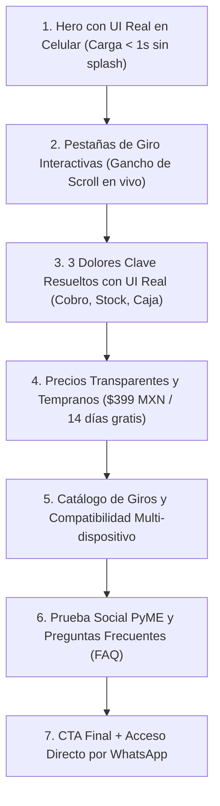

# Plan de Reestructuración de Landing Page y Optimización del Embudo de Conversión — SYMVORA

> **Fecha:** 20 de noviembre de 2026  
> **Objetivo:** Optimizar la landing page principal (`www.symvora.com.mx/es`) y el flujo de registro para capturar tráfico frío proveniente de **Meta Ads (Facebook principalmente)** y **Google**, aumentando el scroll depth y la tasa de conversión a registro de prueba gratuita.

---

## 1. Contexto y Métricas Actuales

- **Dispositivos:**
  - **Celular (Móvil):** 68%
  - **Escritorio (Desktop):** 31%
  - **Tablet:** 1%
- **Fuentes de Tráfico:** Meta Ads (Facebook principalmente) y Google.com.
- **Tasa de Rebote (Bounce Rate):** ~52%.
- **Situación identificada:**
  - Los anuncios anteriores de Meta enviaban a los usuarios directo a la pantalla de `/signup` (formulario de 11 campos en acordeón sin mostrar la app), generando abandono por alta fricción.
  - La nueva campaña dirigirá el tráfico a la **Landing Page principal (`www.symvora.com.mx`)**.
  - Se requiere transformar la landing page para enganchar de inmediato a comerciantes de PyMEs mexicanas (abarrotes, ferreterías, ropa, papelerías, farmacias, etc.), generar interés para que hagan scroll y convertirlos en registros a prueba gratuita de 14 días sin tarjeta.

---

## 2. Diagnóstico de Fricciones en la Landing Actual

1. **Pantalla de carga bloqueante (`SplashEntrada`):**  
   Retiene la pantalla entre 3 y 6 segundos con una animación del logo antes de mostrar contenido. En celulares con conexión móvil (4G), esto detona un rebote inmediato del 50-70% antes de ver el título.
2. **"Show, Don't Tell" ausente en móvil:**  
   En `src/components/marketing/hero.tsx`, el contenedor de mockups `HeroMockups` tiene la clase `hidden lg:flex`. En celular (68% de visitas), el comerciante solo ve texto y viñetas; **nunca ve cómo luce el sistema**.
3. **Módulos explicados con gráficos abstractos:**  
   La sección `Features` utiliza gráficos abstractos (barras de porcentaje, SVG decorativos) en lugar de capturas reales de una pantalla de cobro rápido, inventario con código de barras o un ticket impreso.
4. **Precios y oferta enterrados al final:**  
   El bloque de precios (`id="pricing"`) se encuentra en la sección 14 (al final absoluto). Para comerciantes en México, no ver el precio rápido genera desconfianza o la presunción de que es caro o cobra comisiones ocultas.
5. **Barrera de registro alta:**  
   Al dar clic a "Prueba gratis", `/signup` pide 11 campos y carece de registro rápido con Google (OAuth solo activo en login).

---

## 3. Plan de Reestructuración (Flujo Narrativo Ágil)

El nuevo orden de la landing page sigue una estructura pensada para retener y guiar al usuario hacia la acción:



---

## 4. Cambios Técnicos y de Componentes

### A. Rendimiento y Primer Pintado Inmediato (Above-The-Fold)
- **Archivo:** `src/app/[locale]/page.tsx`
  - Desactivar o condicionar `<SplashEntrada />` para que en la landing pública el contenido (FCP/LCP) se pinte de inmediato en menos de 1 segundo.
- **Archivo:** `src/components/marketing/hero.tsx`
  - Mostrar un mockup nítido del sistema en celular directamente visible en móvil bajo el CTA principal.
  - Ajustar micro-copy del CTA: *"Prueba 14 días gratis — Sin tarjeta de crédito"* y botón secundario *"Ver demo en vivo"*.

### B. Gancho Interactivo de Scroll (Pestañas de Giro)
- **Nuevo componente:** `src/components/marketing/giro-showcase.tsx`
  - Selector con pestañas: **Abarrotes**, **Ropa / Calzado**, **Ferretería**, **Papelería**, **Farmacia**.
  - Al presionar cada pestaña, la pantalla de celular interactiva actualiza en tiempo real:
    - Productos reales de su giro.
    - Cobro en 3 toques con cálculo automático de cambio e IVA.
    - Descuento de stock en tiempo real y ticket digital.
  - Esto genera curiosidad inmediata ("Open Loop") que incita a continuar bajando.

### C. Características con Capturas Reales de la Plataforma
- **Archivo:** `src/components/marketing/features.tsx`
  - Sustituir los gráficos abstractos por capturas y componentes visuales reales:
    1. **Punto de Venta Rápido:** Búsqueda instantánea, escaneo de código de barras, pago mixto (efectivo, tarjeta, fiado/crédito).
    2. **Inventario Bajo Control:** Semáforo de stock bajo, alertas de caducidad y variantes de talla/color.
    3. **Caja y finanzas:** Apertura, control de entradas/salidas de efectivo y reporte de turno al instante.

### D. Sección de Precios Prominente
- **Archivo nuevo o reubicado:** `src/components/marketing/pricing-section.tsx`
  - Ubicación: Inmediatamente después de las características clave.
  - Transparencia total:
    - **$399 MXN / mes** (o badge de promoción de lanzamiento según aplique).
    - **14 días de prueba gratis** garantizados sin ingresar tarjeta de crédito.
    - Usuarios y productos ilimitados.
    - Sin comisiones por venta ("Lo que vendes es 100% tuyo").
    - Soporte humano en español por WhatsApp.

### E. Optimización de la Pantalla de Registro (`/signup`)
- **Archivo:** `src/components/auth/auth-forms.tsx`
  - Incorporar el botón **"Continuar con Google"** en la vista de registro (`mode === "signup"`), permitiendo crear la cuenta en 1 clic.
  - Agregar banner de confianza en la cabecera: *"Tu prueba gratuita de 14 días está lista · Sin tarjeta de crédito · Acceso en 30 segundos"*.

---

## 5. Plan de Verificación

1. **Verificación Automatizada:**
   - Comprobación de tipos y build de producción:
     ```bash
     npm run build
     npm test
     ```
2. **Verificación de Experiencia Móvil:**
   - Inspección en viewport móvil (375px y 412px de ancho).
   - Medición de FCP/LCP para asegurar que la página renderiza sin esperas.
   - Navegación fluida por las pestañas de giro y verificación del flujo completo hacia `/signup`.
